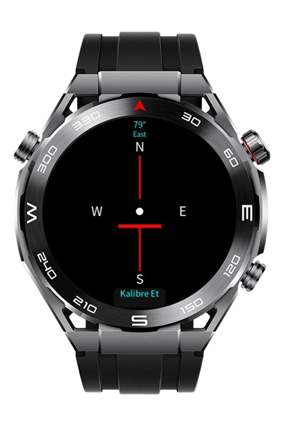

> **Note:** To access all shared projects, get information about environment setup, and view other guides, please visit [Explore-In-HMOS-Wearable Index](https://github.com/Explore-In-HMOS-Wearable/hmos-index).

# Compass App

A minimalist **compass application** designed for HarmonyOS Lite Wearable devices (e.g., Watch GT series).  
It uses the device sensors to calculate the **real-time heading (North angle)** and displays a clean compass needle with degree information.

---

## Preview

<div>    
  
</div> 

---

## Use Cases

- **Quick Direction Check:** Instantly view **North/East/South/West** from your wrist without pulling out your phone.
- **Outdoor & Workout Aid:** Keep your **route orientation** during trekking, running, or cycling.
- **Minimal Interface:** Readable even in sunlight, showing both angle and direction at a glance.

---

## Tech Stack

- **Languages:** JavaScript (HML / CSS / JS)
- **Framework:** HarmonyOS SDK 5.0.0 (API 12) – *Lite Wearable*
- **IDE:** DevEco Studio
- **APIs:** `@system.sensor` (Accelerometer + MagneticField, if supported)

> If the device supports a magnetic field sensor, heading detection is more stable. Otherwise, the app uses accelerometer-based approximation.

---

## Project Structure

```
entry/src/main/
|--- js/MainAbility
|    |--- pages
|    |    |--- index
|    |         |--- index.hml   // Compass needle, degree, and direction label
|    |         |--- index.css   // High-contrast circular design
|    |         |--- index.js    // Sensor reading + heading calculation
|--- config.json                 // Sensor permissions & app metadata
```

---

## Features

- **Real-time heading (0–359°)**
- **Direction label:** N / E / S / W (or localized K / D / G / B)
- **Soft calibration:** Neutral position set at app start
- **Low power consumption:** Optimized sensor refresh rate
- **Touch-free, minimalist usage**

---

# Constraints
## Supported Device

- Huawei Sport (Lite) Watch GT 4/5/6
- Huawei Sport (Lite) GT4/5 Pro
- Huawei Sport (Lite) Fit 3/4
- Huawei Sport (Lite) D2
- Huawei Sport (Lite) Ultimate

- **Limitations:**
    - Calibration resets when the app restarts
    - Background operation not supported (stops when the screen turns off)

---

## License

CompassApp is distributed under the terms of the [MIT License](./LICENSE).
